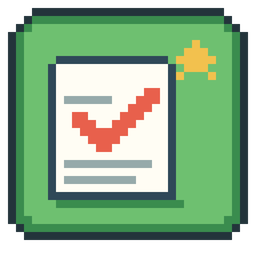
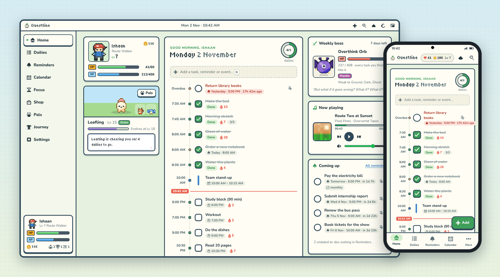
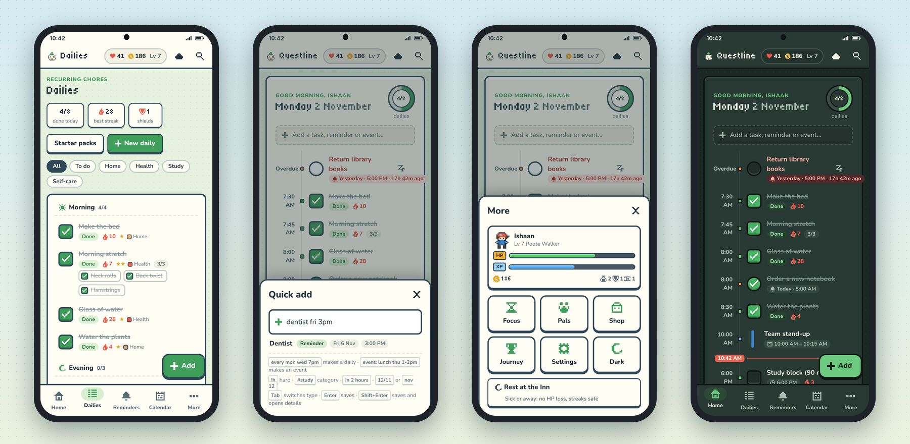
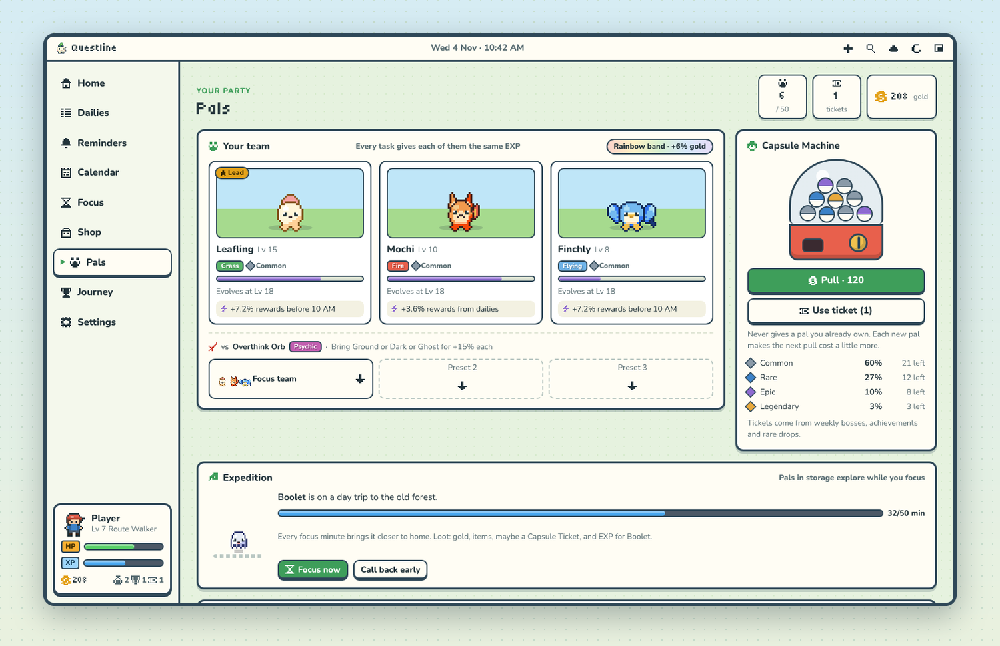
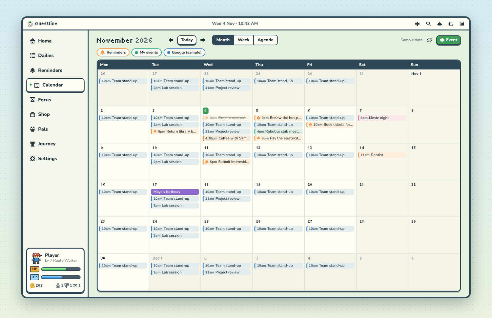
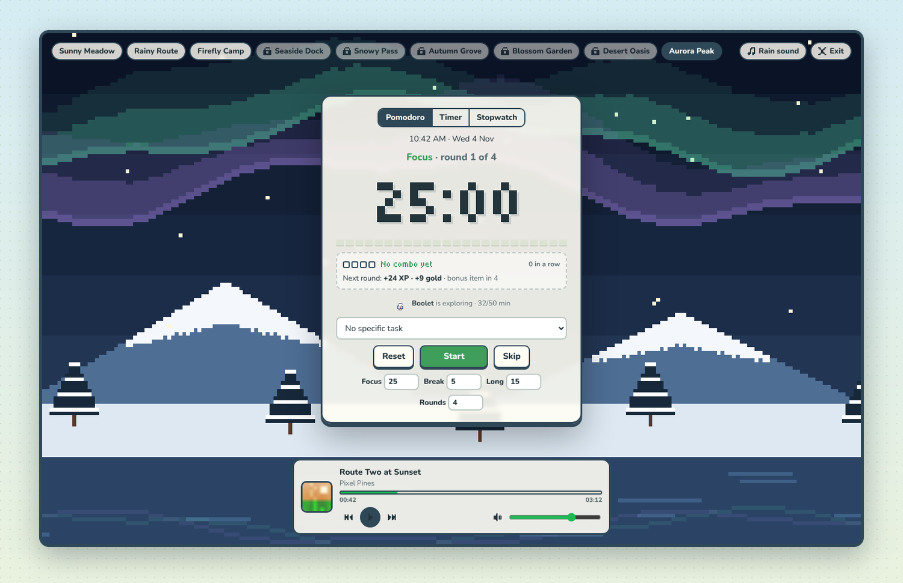
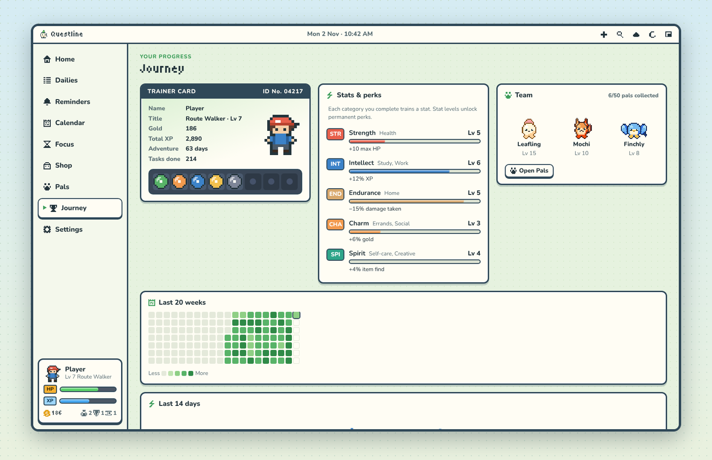
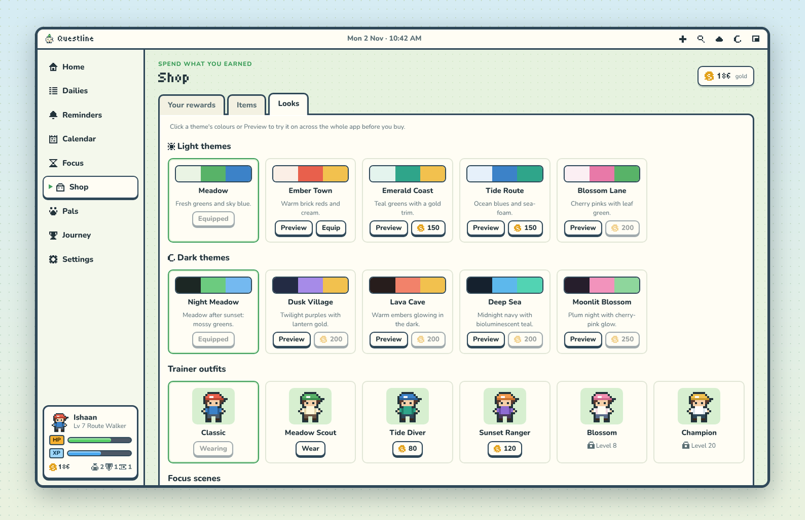
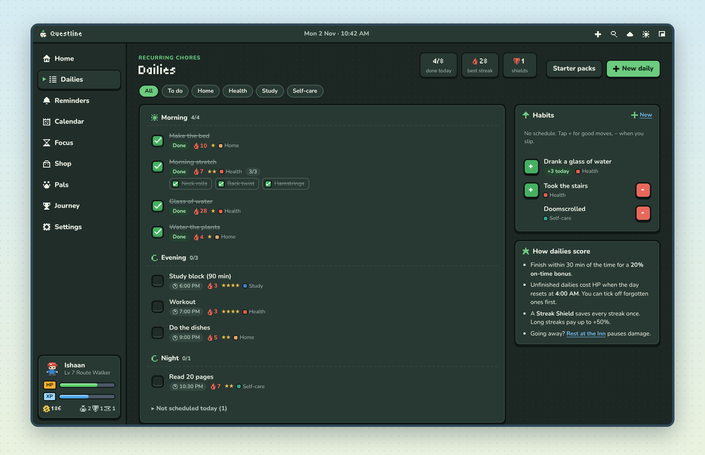

# Questline

### Your to-do list, as a cozy pixel RPG.

Dailies, reminders, a calendar and a focus timer, where getting things done levels you up, 
grows a team of pixel pals and knocks down a weekly boss. For **Windows** and **Android**.

 

## What is it?

Questline is a daily planner that plays like a little handheld RPG. Add your chores,
reminders and events; tick them off and you earn **XP and gold**, your **pals** gain
EXP and evolve, and the **weekly boss** takes damage. Skip things and you lose a bit
of HP. It's never punishing, just enough to make "I'll do it tomorrow" sting.

It runs on your PC (quietly, from the system tray) and on your Android phone, and keeps
both in sync through **your own Google Drive**. There's no account to create and no
server in between.

## How it works

| Step | What happens |
|---|---|
| **1. Add your day** | Type it the way you'd say it: `gym mon wed fri 7pm`, `dentist fri 3pm`, `pay rent tomorrow !h`. Questline works out the date, time and repeat. |
| **2. Get it done** | Tick things off for XP, gold and loot. Doing a task within 30 minutes of its time pays an on-time bonus; streaks pay more. |
| **3. Grow your team** | Your three pals share every bit of EXP you earn and evolve as they level up. Win new ones from the Capsule Machine: 50 to collect, three of them legendary. |
| **4. Beat the boss** | Every completed task hits this week's boss; every miss heals it. Defeat it by the end of the week for gold, XP and a capsule ticket. |
| **5. Go easy on yourself** | Sick or travelling? Rest at the Inn and nothing hurts. Weekends can be rest days. Forgot to tick something yesterday? Record it before the day settles. |

## On your phone

The Android app is the same Questline with a layout made for one thumb: tabs along the
bottom, a big **+ Add** button, dialogs that slide up, haptics, and reminders that
arrive as notifications even when the app is closed.

## A look around

<table>
  <tr>
    <td width="50%"> <b>Pals</b>: your team of three, presets, the Capsule Machine and the Paldex.</td>
    <td width="50%"> <b>Calendar</b>: month, week and agenda views, with your Google Calendar if you like.</td>
  </tr>
  <tr>
    <td width="50%"> <b>Focus mode</b>: Pomodoro, timer or stopwatch over a slow pixel scene. Sessions earn XP.</td>
    <td width="50%"> <b>Journey</b>: trainer card, badges, stats with perks, your streak heatmap and achievements.</td>
  </tr>
  <tr>
    <td width="50%"> <b>Shop</b>: spend gold on your own real-life rewards, items, town themes, outfits and focus scenes.</td>
    <td width="50%"> <b>Dark mode</b>: every theme has a light and a dark version, and you can try any of them before buying.</td>
  </tr>
</table>

## Features at a glance

- **Planner**: timed dailies with checklists, habits (+/−), one-off and repeating reminders, events, snooze, and a full-page calendar.
- **Game**: XP, gold, HP, levels and titles; 50 pals across 9 types with abilities and team synergy; weekly bosses; 34 achievements; loot drops; a shop for your own real-life rewards.
- **Focus**: full-screen Pomodoro, timer and stopwatch with ambient pixel scenes, rain sounds and Spotify controls; landscape mode on phones.
- **Sync & backups**: sign in with Google to sync PC and phone, with daily backups in a normal `Questline` folder in your Drive. Restore any backup in two taps.
- **Calendar**: optional two-way Google Calendar, plus read-only iCal feeds (holidays, timetables, Outlook).
- **Spotify**: see and control what's playing from Home, focus mode or the mini window.
- **Desktop niceties**: tray icon, quick add from any app (`Ctrl+Alt+Q`), command palette (`Ctrl+K`), notifications with the window closed, mini window, start with Windows.
- **Updates itself**: new versions arrive from GitHub on both PC and phone; nothing installs without your OK.

## Get started

**Windows**: download `Questline_x.y.z_x64-setup.exe` from the [latest release](https://github.com/Ishaan415/questline/releases/latest) and run it. Windows may show "Windows protected your PC" for new apps: **More info → Run anyway**.

**Android**: open [Questline-android.apk](https://github.com/Ishaan415/questline/releases/latest/download/Questline-android.apk) on your phone and install it (Android asks you to allow installs from your browser once).

**Then**: pick your starter pal, choose a few starter packs or add your own tasks, and you're playing. To use more than one device, go to **Settings → Google account → Sign in with Google** on each one.

## Your data stays yours

Questline has **no servers**. Everything is saved on your device and, if you sign in,
in your own Google Drive, where Questline can only see the files it created (Google's
`drive.file` permission). Nothing is sent to the developer, sold or used for ads. Read
the [privacy policy](https://ishaan415.github.io/questline/privacy.html).

---

<b>Contents of the full guide</b>

1. [What's inside](#1-whats-inside)
2. [How the game works](#2-how-the-game-works)
3. [Google account: sync, backups and Calendar](#3-google-account-sync-backups-and-calendar)
4. [Spotify](#4-spotify)
5. [Installing and updating](#5-installing-and-updating)
6. [Troubleshooting](#6-troubleshooting)
7. [Credits and legal](#7-credits-and-legal)

# Full guide

## 1. What's inside

| Area | What it does |
|---|---|
| **Home** | Trainer card (level, HP, XP, gold), your lead pal with a dialog box (teammates beside it), today's timeline merging timed dailies, reminders and events with a "now" line, weekly boss, Spotify player, what's coming up. |
| **Dailies** | Recurring chores with an optional time of day, grouped Morning / Afternoon / Evening / Night. Schedules: every day, certain weekdays, every N days, monthly. Difficulty, category, checklist steps, heads-up notification, streaks. Habits (+/−) live here too. |
| **Reminders** | One-off or repeating tasks with a date and time ("Book tickets for the show, Fri 10:00 AM"). Overdue / Today / Tomorrow / Next 7 days / Later / No date. Snooze 10 min, 1 hour, tonight, tomorrow, next week. |
| **Calendar** | A full page, not a corner widget. Month, week (time grid) and agenda views; click a day for its details; click an empty hour in week view to add an event. Shows your events and reminders, **never dailies**. |
| **Focus** | Full-screen Pomodoro, countdown timer or stopwatch over a slow pixel scene (meadow, rain, firefly camp, seaside, snow), optional soft rain sound, Spotify controls only. Controls fade out while it runs. Sessions earn XP. |
| **Shop** | Your own real-life rewards priced in gold, items (Potions, Streak Shields, Lucky Charm), town themes (preview any theme across the whole app before buying), trainer outfits and focus scenes. |
| **Pals** | Your team of 3, team presets, the Capsule Machine, and the Paldex of all 50 pals (silhouettes for the ones you haven't caught). Click any pal for its evolution line, level, ability and lore. |
| **Journey** | Trainer card with 8 badges, five stats with perks, your team, 20-week heatmap, 14-day chart, 34 achievements with rewards, adventure log. |

### Quality-of-life features

- **Natural-language quick add** from anywhere with `Ctrl+Alt+Q`, or `N` inside the
  app: `dentist fri 3pm`, `water plants every mon thu 8:30am`,
  `event: project review thu 2-3pm`, `pay rent tomorrow 6pm !h #errands`,
  `call the bank in 2 hours`, `12/11` (DD/MM) or `nov 12`. `Tab` switches the type.
- **Command palette** `Ctrl+K`: jump anywhere, search tasks, use items, pause notifications.
- **Tray icon** with quick add, focus, mini window, snooze last reminder, pause notifications.
  Left-click toggles the window. Tooltip shows level, dailies left and the next alarm.
- **Notifications keep working with the window closed**, with quiet hours, muting during
  focus and a per-task heads-up. On Android they arrive even when the app is closed.
- **Mini window**: a small always-on-top view of today's list plus Spotify.
- **Start with Windows** (starts hidden in the tray), single instance, close-to-tray.
- **Record yesterday**: when a new day starts you can tick off things you did but
  forgot to log, before any damage applies.
- **Rest at the Inn**: pauses damage and keeps streaks while you're sick or away.
- **Weekend mode** (Settings → Day & time): make Sundays, or Saturdays and Sundays,
  rest days. Missed dailies on rest days cost no HP and keep their streaks; anything
  you do still pays out.
- **Custom day start** (default 4 AM) so late nights still count as "today".
- Undo after completing or deleting, repeating reminders that roll forward,
  "move all overdue to tomorrow", starter packs, 12/24-hour clock, Monday/Sunday weeks,
  six colour themes, interface size, reduced motion, sound volume.
- **Backups**: a daily local copy kept for 14 days, export/import as a file, and (if you
  sign in) daily backups in your Google Drive.

### Keyboard (Windows)

| Keys | Action |
|---|---|
| `Ctrl+Alt+Q` | Quick add from any app |
| `Ctrl+Alt+F` | Focus mode from any app |
| `Ctrl+Alt+H` | Show / hide Questline |
| `N` | Quick add |
| `Ctrl+K` or `/` | Command palette |
| `1`–`9` | Pages (5 is Focus, 7 is Pals) |
| `F` | Focus mode |
| `←` `→` `T` `M` `W` `A` | Calendar: previous, next, today, month, week, agenda |
| `Space` `R` `S` `Esc` | Focus: start/pause, reset, skip, exit |
| `?` | Shortcut help |

---

## 2. How the game works

The design borrows what works from several apps and leaves out what makes
people quit: Habitica's XP/gold/HP loop and "record yesterday", Finch's growing
companion (here: a collectable team), Duolingo's streak freeze, and a solo version of Habitica's boss quests.

- **XP and gold** for every daily, reminder, habit (+) and focus session.
  Difficulty multiplies rewards (Trivial ½×, Easy 1×, Medium 1.5×, Hard 2×).
- **On-time bonus**: finishing a timed daily or a reminder within 30 minutes of its
  time pays +20%. Long streaks add up to +50%.
- **HP**: unfinished dailies cost HP at the day reset, scaled by difficulty;
  completed checklist steps reduce it. Habits (−) cost a little HP.
- **Fainting** (HP 0) costs half your gold. Levels, items and records are safe.
- **Streak Shield**: used automatically on a bad day, keeps every streak alive.
- **Levels** fully heal you and pay gold. Titles change as you go (Rookie → Legend).
- **Stats**: each category trains a stat. Strength (Health) +2 max HP per level,
  Intellect (Study, Work) +2% XP, Endurance (Home) −3% damage, Charm (Errands, Social)
  +2% gold, Spirit (Self-care, Creative) +1% item finds.
- **Pals**: 50 evolution lines across 9 types (Fire, Water, Grass, Ground, Flying,
  Dark, Fairy, Ghost, Psychic), each with 4 or 5 forms. Rarities: 26 Common, 13 Rare,
  8 Epic, 3 Legendary. You start with Sprigg, Coalby or Drizzle.
  - **Team of 3**: every task, reminder, habit (+) or focus round gives each team pal
    the same EXP as the XP you earned. Pals in storage get nothing.
  - **Evolution** by level: 4-form lines evolve at Lv 8 / 18 / 30, 5-form lines at
    Lv 7 / 15 / 26 / 40. Rarer pals need a bit more EXP per level.
  - **Abilities**: one per evolution line (e.g. Coalby's *Stoke the Fire*: more boss
    damage). Only team pals' abilities are active, and they grow stronger with each form.
    Rarer pals have stronger abilities.
  - **Synergy**: 3 pals of one type gives +15% pal EXP; 3 different types gives +6% gold.
  - **Boss types**: each weekly boss has a type. Every team pal that is strong against
    it adds +15% boss damage.
  - **Capsule Machine**: pull with gold or a Capsule Ticket. It never repeats a pal you
    own, and each new pal raises the price (80 gold, then +8 per pal). Tickets come from
    weekly bosses, achievements and rare drops.
  - **Presets**: save up to 3 teams (e.g. Focus team, Boss team) and swap in one click.
  - Your lead pal's mood follows your day.
- **Weekly boss**: its HP matches the dailies you have scheduled that week (harder ones
  count more) and grows if you add dailies mid-week, so beating it takes most of your
  week's dailies. Every completion hits it; every miss heals it. Beat it by the end of the week for
  gold, XP and loot.
- **Drops**: completing tasks sometimes finds gold pouches, Potions, a shield or, rarely,
  a Capsule Ticket (max 6 a day).
- **Achievements** pay gold and sometimes Capsule Tickets when they unlock.

All sprites and creatures are original pixel art; the colour palettes are inspired
by GBA/NDS-era handheld games.

---

## 3. Google account: sync, backups and Calendar

Signing in is optional. Questline works fully offline without it.

**Sign in**

1. Open **Settings → Google account** and press **Sign in with Google**.
2. Pick your account. On Windows this happens in your browser; on Android, in Google's
   own account picker.
3. Allow access. Questline asks only for your name and email, and for access to the
   files *it creates* in your Drive. It can't see anything else in your Drive.

Do the same on each device you use. If a device has nothing on it yet, it picks up your
progress from Drive automatically.

**What you get**

- **Sync across devices**: tasks, progress and pals stay the same on your PC and phone.
  Each device keeps its own window, sound, notification and theme settings.
- **Daily backups** in a normal folder in your Drive: `My Drive/Questline/Backups`.
- **Restore**: **Settings → Google account → Restore…** lists your backups with what's
  in each one ("Lv 3 · 5 dailies · 2 reminders · 80 gold") and which device made it.
  Pick one to put it back on every device. Your current progress is backed up first.

**How sync works**

Questline syncs when it starts, shortly after you change something, every few minutes
while it's open, and when you tap the cloud icon in the top bar (green = synced,
blinking = syncing, red = problem). Both devices can be used offline: when they meet,
changes are merged rather than overwritten. New tasks from either side are kept, gold
and XP earned on both devices add up, and if the same thing was edited on both, the
most recent edit wins. The first time a device that already has its own progress meets
your Drive copy, you choose which one to keep, and the other is saved as a backup.

**Google Calendar (optional)**

1. In **Settings → Google account**, press **Turn on Google Calendar**.
2. Google asks for permission to see and edit your calendars. It may show a
   *"Google hasn't verified this app"* notice: choose **Advanced → Go to Questline**.
3. Tick the calendars you want to see.

Then:
- Events from those calendars appear on the Calendar page; events on calendars you can
  edit can also be changed from Questline.
- Events you create in Questline are added to the calendar you choose.
- Reminders can be added too, as 30-minute entries (without duplicate Google alerts).
- Dailies are never sent.

**Other calendars (read-only):** **Settings → Subscribed calendars** accepts any iCal
link (`https://…` or `webcal://…`): Google's "secret address in iCal format", Outlook's
"Publish a calendar" link, iCloud public calendars, timetables and holiday calendars.

**Signing out:** **Settings → Google account → Sign out of Google**. You can also remove
Questline's access at any time at [myaccount.google.com/permissions](https://myaccount.google.com/permissions),
and delete the `Questline` folder in your Drive to remove synced data and backups.

---

## 4. Spotify

On **Windows**, Questline shows and controls the official Spotify app automatically:
no setup, no login, free accounts included.

To also control playback on other devices (your phone, a speaker, the web player,
other Spotify apps), or to use Spotify in the **Android** app, connect your Spotify
account. This needs **Spotify Premium** and takes about five minutes, once:

1. Go to [developer.spotify.com/dashboard](https://developer.spotify.com/dashboard)
   and log in with your Spotify account.
2. Press **Create app**. Give it any name and description. Under **Redirect URIs**, add
   exactly `http://127.0.0.1:43821/callback`. Tick **Web API**, accept the terms and save.
3. Open the app's **Settings** and copy the **Client ID**.
4. In Questline: **Settings → Spotify**, paste the Client ID and press
   **Connect Spotify account**, then approve in the browser.

This creates a personal Spotify app that only you use; Questline never sees your
Spotify password. If you sign in with Google, your Client ID is synced to your other
devices, so there you only need to press **Connect Spotify account**.

---

## 5. Installing and updating

**Windows 10/11**: download `Questline_x.y.z_x64-setup.exe` from the
[latest release](https://github.com/Ishaan415/questline/releases/latest) and run it.
Because the installer isn't code-signed, Windows may show *"Windows protected your PC"*:
choose **More info → Run anyway**. Questline then lives in the system tray.

**Android 8 or newer**: open
[Questline-android.apk](https://github.com/Ishaan415/questline/releases/latest/download/Questline-android.apk)
on your phone and install it. Android asks you once to allow installs from your browser.
On first launch, allow notifications so reminders can reach you.

**Updates**: both apps check for new versions on start and every few hours, and tell
you when one is ready (**Settings → Updates** to check now or turn this off). Nothing
installs without your OK. On Windows the app closes, updates and reopens by itself; on
Android, the system installer asks you to confirm.

**Your data**: saved on your device (Windows: `%APPDATA%\com.questline.app`, reachable
via **Settings → Open data folder**; Android: the app's private storage), plus your
Google Drive if you sign in.

**Lightweight**: Questline is built with [Tauri](https://tauri.app), so the Windows
installer is a few MB and the app idles at roughly 0% CPU and 60–120 MB of RAM.

---

## 6. Troubleshooting

- **No notifications on Windows**: check **Focus assist / Do not disturb** and
  Questline's quiet hours (Settings → Notifications). **Send a test** checks the whole path.
- **No notifications on Android**: allow notifications for Questline in Android's
  settings, and exclude it from battery optimisation if reminders arrive late.
- **A keyboard shortcut does nothing (Windows)**: another app already uses that key
  combination.
- **Spotify says nothing is playing**: start playback once in the Spotify app. To see
  other devices, connect your Spotify account (section 4).
- **Google sign-in or sync shows an error**: check your internet connection and try
  **Sync now**. If it keeps failing, sign out and sign in again.
- **Android won't install the update**: allow Questline to install apps when Android
  asks (Settings → Apps → Questline → Install unknown apps).

---

## 7. Credits and legal

- **Privacy**: Questline has no servers and collects nothing. See the
  [privacy policy](https://ishaan415.github.io/questline/privacy.html).
- **Artwork**: all sprites, pals and bosses are original pixel art made for Questline;
  the colour palettes are inspired by classic handheld games.
- **Third-party software** (licence texts are included with the app):
  - [Tauri](https://tauri.app): MIT / Apache-2.0
  - [ical.js](https://github.com/kewisch/ical.js): Mozilla Public License 2.0
  - Fonts [Tiny5](https://fonts.google.com/specimen/Tiny5), [Nunito](https://fonts.google.com/specimen/Nunito)
    and [Fredoka](https://fonts.google.com/specimen/Fredoka): SIL Open Font License 1.1
- **Trademarks**: Questline is an independent project and is not affiliated with,
  endorsed by or sponsored by Google, Spotify or Microsoft. Google, Google Drive and
  Google Calendar are trademarks of Google LLC; Spotify is a trademark of Spotify AB;
  Windows is a trademark of Microsoft Corporation; Android is a trademark of Google LLC.

---

Want to build it yourself? Questline is a Tauri 2 app (Rust shell, plain
HTML/CSS/JS interface in `src/`). With Node.js, Rust and
[Tauri's prerequisites](https://tauri.app/start/prerequisites/) installed:
`npm install` then `npm run dev`.
